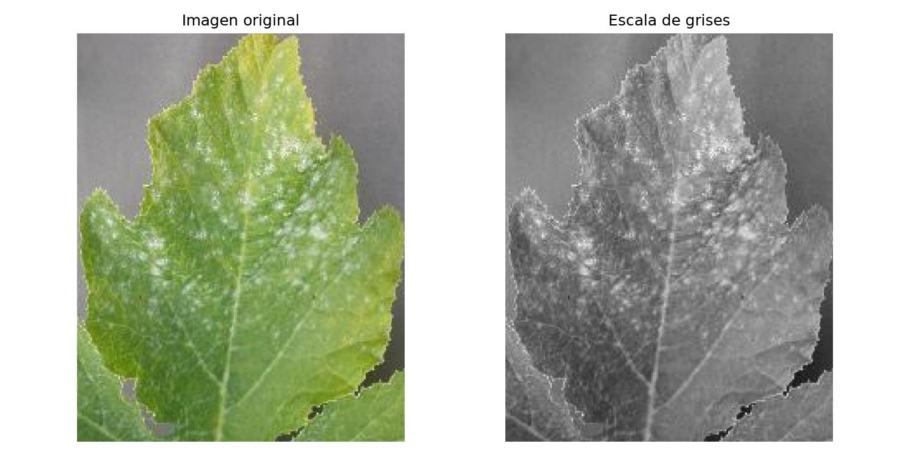
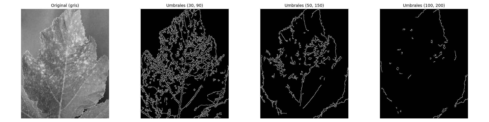
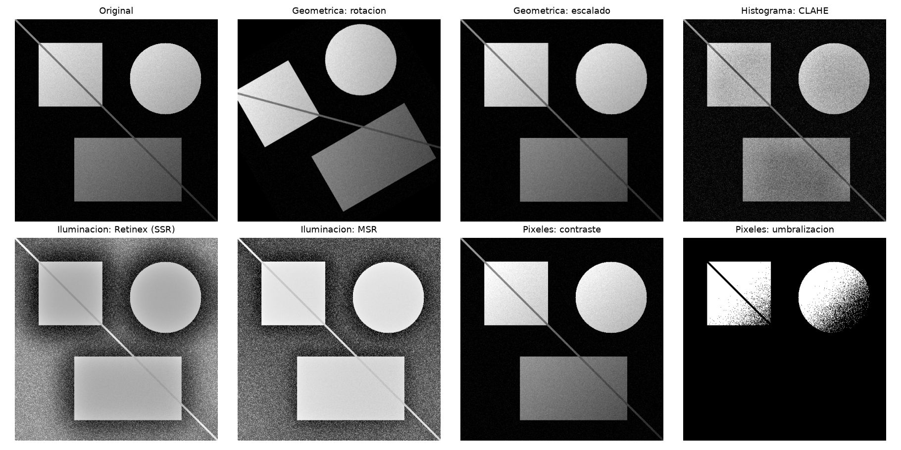
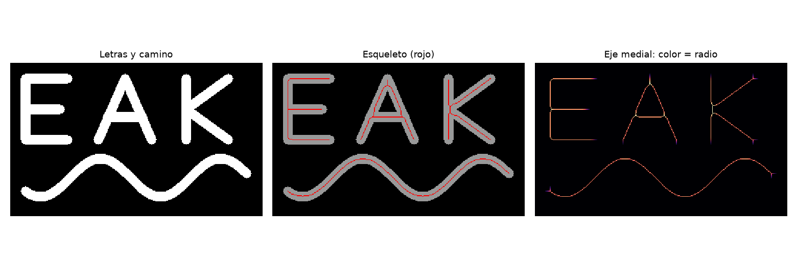
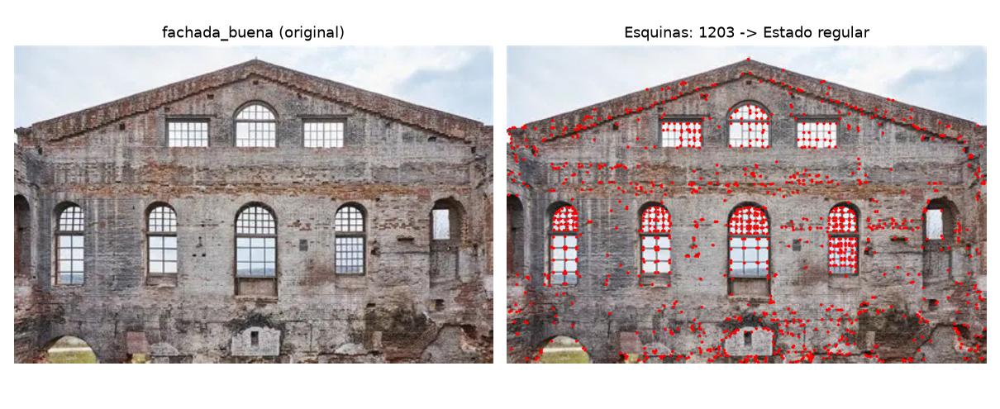

<div align="center">

#  Percepción Computacional
### Laboratorios del Primer Componente · Ciclo 2026-2

Procesamiento digital de imágenes y visión por computador con **Python**, **OpenCV**, **scikit-image** y **SciPy**.


**Autor:** Torres Ruiz Angel Eduardo

</div>

---

## Contenido

[Resumen](#-resumen) · [Estructura](#-estructura-del-repositorio) · [Laboratorios](#-laboratorios) · [Instalación](#-instalación) · [Ejecución](#-ejecución) · [Resultados](#-resumen-de-resultados)

---

## Resumen

Seis laboratorios, uno por semana, que recorren el flujo clásico del procesamiento de imágenes: desde verificar el entorno hasta detectar características en fotografías reales.

| Semana | Tema | Técnicas principales |
|:---:|---|---|
| **S01** | Fundamentos | NumPy, filtro gaussiano con SciPy, bordes con OpenCV |
| **S02** | Lectura y conversión | Carga de imagen y escala de grises |
| **S03** | Filtrado y bordes | Filtro de mediana, filtro Gaussiano, detector de Canny |
| **S04** | Mejora de imagen | Geometría, histogramas, Retinex, operaciones sobre píxeles |
| **S05** | Morfología matemática | Área abierta, relleno, adelgazamiento, esqueleto, h-mínima |
| **S06** | Detección de características | Esquinas de Harris para evaluar fachadas |

Cada laboratorio es **autocontenido**: se ejecuta desde su propia carpeta y deja sus evidencias en `resultados/`.

---

## Estructura del repositorio

```text
LABs_1erComponente_Percep/
│
├── LAB_S01_2026-2/
│   ├── LAB_S1_3Ejemplos.py
│   └── resultados/                  salida_consola.txt
│
├── LAB_S02_2026-2/
│   ├── LAB-02_procesamiento_imagen.py
│   ├── planta.jpg                   ← imagen de entrada
│   └── resultados/                  planta_gris · comparación
│
├── LAB_S03_2026-2/
│   ├── LAB-03_000300122_procesamiento_imagenes.py
│   ├── planta.jpg                   ← imagen de entrada
│   └── resultados/                  Caso_1_Mediana · Caso_2_Gaussiano · Caso_3_Canny
│
├── LAB_S04_2026-2/
│   ├── Lab_04_000300122_proyecto_pdi.py
│   └── resultados/                  17 imágenes (geometría, histogramas, iluminación, píxeles)
│
├── LAB_S05_2026-2/
│   ├── LAB_S05_000300122_actividad_morfologia.py
│   └── resultados/                  7 figuras (casos 1 a 5)
│
├── LAB_S06_2026-2/
│   ├── LAB_S06_000300122_actividad_harris_fachadas.py
│   ├── fachada_buena.jpg            ← imagen de entrada
│   └── resultados/                  esquinas marcadas · resumen
│
└── README.md
```

---

## Laboratorios

### S01 · Ejemplos de NumPy, SciPy y OpenCV
[`LAB_S01_2026-2/LAB_S1_3Ejemplos.py`](LAB_S01_2026-2/LAB_S1_3Ejemplos.py)

Tres ejemplos independientes que verifican el entorno de trabajo.

| Librería | Ejemplo | Resultado |
|---|---|---|
| NumPy | Promedio y transpuesta de una matriz 3×3 | — |
| SciPy | Filtro gaussiano (`σ = 1`) sobre una imagen 7×7 con un píxel encendido | Valor central `1.0 → 0.1592`; la suma de intensidades se conserva en `1.0` |
| OpenCV | Detección de bordes **Canny** sobre un cuadrado sintético | **240 px** de borde |

---

### S02 · Lectura y conversión a escala de grises
[`LAB_S02_2026-2/LAB-02_procesamiento_imagen.py`](LAB_S02_2026-2/LAB-02_procesamiento_imagen.py)

- **Actividad A:** lectura de la imagen con OpenCV (`planta.jpg`, **482 × 387 px, 3 canales**).
- **Actividad B:** conversión a escala de grises (**1 canal**) y comparación lado a lado.

Si no se indica una imagen, el script abre un selector de archivos (`tkinter`).

<div align="center">

</div>

---

### S03 · Filtrado de ruido y detección de bordes
📄 [`LAB_S03_2026-2/LAB-03_000300122_procesamiento_imagenes.py`](LAB_S03_2026-2/LAB-03_000300122_procesamiento_imagenes.py)

Tres casos seleccionables por línea de comandos (`--caso 1 | 2 | 3 | todos`):

| Caso | Técnica | Parámetros |
|:---:|---|---|
| **1** | **Filtro de mediana** contra ruido sal y pimienta | kernel 5×5; `--generar-ruido` sintetiza el ruido antes de filtrar |
| **2** | **Filtro Gaussiano** con comparación de kernels | 3, 7 y 15 |
| **3** | **Detector de Canny** con suavizado previo | umbrales 50 / 150, y comparación de los pares (30, 90), (50, 150) y (100, 200) |

Cada caso guarda su secuencia de pasos y una figura comparativa en su propia subcarpeta.

<div align="center">

</div>

---

### 🔹 S04 · Proyecto de Procesamiento Digital de Imágenes
[`LAB_S04_2026-2/Lab_04_000300122_proyecto_pdi.py`](LAB_S04_2026-2/Lab_04_000300122_proyecto_pdi.py)

Basado en **Wu et al. (2024), _A Retinex-based network for image enhancement in low-light environments_, PLoS ONE 19(5): e0303696**. El artículo descompone una imagen como

> **S(x, y) = R(x, y) · L(x, y)** &nbsp;(reflectancia × iluminación)

y a partir de esa idea se implementan, de forma clásica y sin redes neuronales, cuatro bloques:

| # | Bloque | Técnicas |
|:---:|---|---|
| 1 | Transformaciones geométricas | Traslación, rotación, escalado, reflexión |
| 2 | Ecualización de histogramas | Global y **CLAHE** |
| 3 | Corrección de iluminación | **Retinex** (SSR y MSR), corrección gamma, mapa de luz estimado |
| 4 | Operaciones sobre píxeles | Brillo, contraste, negativo, umbralización |

Si no se indica una imagen, el script genera una **imagen sintética con iluminación no uniforme**, de modo que el experimento se reproduce sin ningún archivo externo.

<div align="center">

</div>

---

### S05 · Operaciones morfológicas
[`LAB_S05_2026-2/LAB_S05_000300122_actividad_morfologia.py`](LAB_S05_2026-2/LAB_S05_000300122_actividad_morfologia.py)

Cinco casos de **morfología matemática** con `scikit-image` y `SciPy`:

| Caso | Operación | Observación |
|:---:|---|---|
| 1 | Área abierta (`area_opening`) | Elimina componentes pequeños |
| 2 | Rellenar agujeros | Incluye un análisis de su limitación |
| 3 | Adelgazamiento (`thin`) | La forma se reduce a 1 179 px (tras 8 → 15 iteraciones → completo), siempre con 1 componente conexa |
| 4 | Esqueletización | El esqueleto conserva el **6,9 %** de los píxeles (895 de 12 919) |
| 5 | **H-mínima** + watershed | **137 → 3** regiones con `h = 30` |

<div align="center">

</div>

---

### S06 · Evaluación de fachadas con el detector de Harris
[`LAB_S06_2026-2/LAB_S06_000300122_actividad_harris_fachadas.py`](LAB_S06_2026-2/LAB_S06_000300122_actividad_harris_fachadas.py)

A partir del número de esquinas detectadas se estima el estado de conservación de una fachada:

1. Carga de *n* imágenes (por argumentos o con selector de archivos).
2. Normalización a **1000 px de ancho**, para que los conteos sean comparables.
3. Detección de esquinas con **Harris** (`blockSize = 2`, `ksize = 3`, `k = 0.04`, umbral relativo del 1 %).
4. Conteo y marcado de las esquinas sobre la imagen.
5. Clasificación:

| Esquinas | Diagnóstico |
|---|---|
| más de 1500 | 🟢 Buen estado |
| entre 700 y 1500 | 🟠 Estado regular |
| menos de 700 | 🔴 Estado deteriorado |

**Resultado con `fachada_buena.jpg`:** 1 203 esquinas → 🟠 *Estado regular*.

<div align="center">

</div>

---

## Instalación

Requiere **Python 3.10 o superior** (probado con 3.12). Se recomienda un entorno virtual.

```powershell
python -m venv .venv
.venv\Scripts\Activate.ps1

pip install numpy scipy matplotlib opencv-python scikit-image
```

> `tkinter` viene incluido con el instalador oficial de Python para Windows.

---

## Ejecución

Cada laboratorio se ejecuta **desde su propia carpeta**, porque las salidas se escriben en `resultados/` relativa al directorio actual.

```powershell
# S01 · Fundamentos
cd LAB_S01_2026-2
python LAB_S1_3Ejemplos.py

# S02 · Lectura y escala de grises
cd ..\LAB_S02_2026-2
python LAB-02_procesamiento_imagen.py planta.jpg

# S03 · Filtros y Canny (todos los casos, con ruido sintético)
cd ..\LAB_S03_2026-2
python LAB-03_000300122_procesamiento_imagenes.py --imagen planta.jpg --caso todos --generar-ruido

# S04 · Proyecto de PDI (usa imagen sintética si no se indica otra)
cd ..\LAB_S04_2026-2
python Lab_04_000300122_proyecto_pdi.py

# S05 · Morfología matemática
cd ..\LAB_S05_2026-2
python LAB_S05_000300122_actividad_morfologia.py

# S06 · Harris sobre fachadas (una o varias imágenes)
cd ..\LAB_S06_2026-2
python LAB_S06_000300122_actividad_harris_fachadas.py fachada_buena.jpg
```

---

## Resumen de resultados

| Semana | Resultado |
|:---:|---|
| S01 | Canny detecta **240 px** de borde en el cuadrado sintético |
| S02 | Imagen `482 × 387` convertida de 3 canales a **1 canal** |
| S03 | **3 casos** (mediana, Gaussiano, Canny) con **11 imágenes** de evidencia |
| S04 | **17 imágenes** de geometría, histogramas, iluminación y píxeles |
| S05 | Esqueleto de **895 px** a partir de una forma de 12 919 px; **137 → 3** regiones con h-mínima |
| S06 | `fachada_buena.jpg`: **1 203 esquinas** → *Estado regular* |

<div align="center">

Hecho por **Torres Ruiz, Angel Eduardo** · Percepción Computacional · 2026-2 - UPAO

</div>
